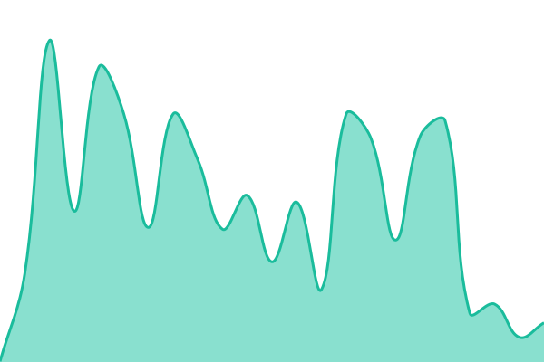

# [📈 Live Status](https://Knowasiak.github.io/status): <!--live status--> **🟥 Complete outage**

This repository contains the open-source uptime monitor and status page for [Aditya Gaurav](www.knowasiak.com), powered by [Upptime](https://github.com/upptime/upptime).

With [Upptime](https://upptime.js.org), you can get your own unlimited and free uptime monitor and status page, powered entirely by a GitHub repository. We use [Issues](https://github.com/Knowasiak/status/issues) as incident reports, [Actions](https://github.com/Knowasiak/status/actions) as uptime monitors, and [Pages](https://Knowasiak.github.io/status) for the status page.

<!--start: status pages-->
<!-- This summary is generated by Upptime (https://github.com/upptime/upptime) -->
<!-- Do not edit this manually, your changes will be overwritten -->
<!-- prettier-ignore -->
| URL | Status | History | Response Time | Uptime |
| --- | ------ | ------- | ------------- | ------ |
|  [Website](https://knowasiak.com) | 🟥 Down | [website.yml](https://github.com/Knowasiak/status/commits/HEAD/history/website.yml) | 

 605ms
     
 | 

<a href="https://Knowasiak.github.io/status/history/website">97.25%</a>
    

|  [Explore](https://knowasiak.com/explore) | 🟥 Down | [explore.yml](https://github.com/Knowasiak/status/commits/HEAD/history/explore.yml) | 

 550ms
     
 | 

<a href="https://Knowasiak.github.io/status/history/explore">97.30%</a>
    

|  [App and database](https://knowasiak.com/health.php) | 🟥 Down | [app-and-database.yml](https://github.com/Knowasiak/status/commits/HEAD/history/app-and-database.yml) | 

 291ms
     
 | 

<a href="https://Knowasiak.github.io/status/history/app-and-database">97.16%</a>
    

<!--end: status pages-->

[**Visit our status website →**](https://Knowasiak.github.io/status)

## 📄 License

- Powered by: [Upptime](https://github.com/upptime/upptime)
- Code: [MIT](./LICENSE) © [Anand Chowdhary](https://anandchowdhary.com)
- Data in the `./history` directory: [Open Database License](https://opendatacommons.org/licenses/odbl/1-0/)
